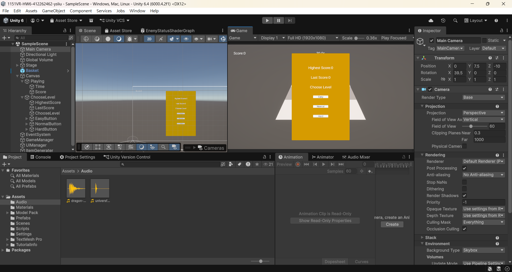

1. 專案截圖

2. github連結
https://github.com/OuO1234567888/1151VR-HW6-412262462-ysliu

3. youtube連結
https://youtu.be/HD2Kt1-dUbQ

4. 說明製作流程和相關操作
利用九個plane建立九宮格場景，匯入籃子、蘋果和炸彈模型，籃子掛上BasketController用Raycast判斷點到哪個plane後移到對應位置。蘋果和炸彈加上標籤，掛上ItemController控制落下，籃子碰到蘋果+100分，碰到炸彈-200分。GameManager負責遊戲時間、分數和遊戲狀態。UIManager負責切換難度選單與遊戲中的介面，並更新時間和分數文字。ItemController根據參數生成蘋果和炸彈。

簡單難度:生成間隔1.5秒、炸彈機率30%、速度每秒3單位
普通難度:生成間隔1秒、炸彈機率40%、速度每秒5單位
困難難度:生成間隔0.5秒、炸彈機率50%、速度每秒7單位
隨著難度提升炸彈機率和速度，減少生成間隔，讓低難度可以穩定拿分數，高難度分數上限提升但更需要技術
